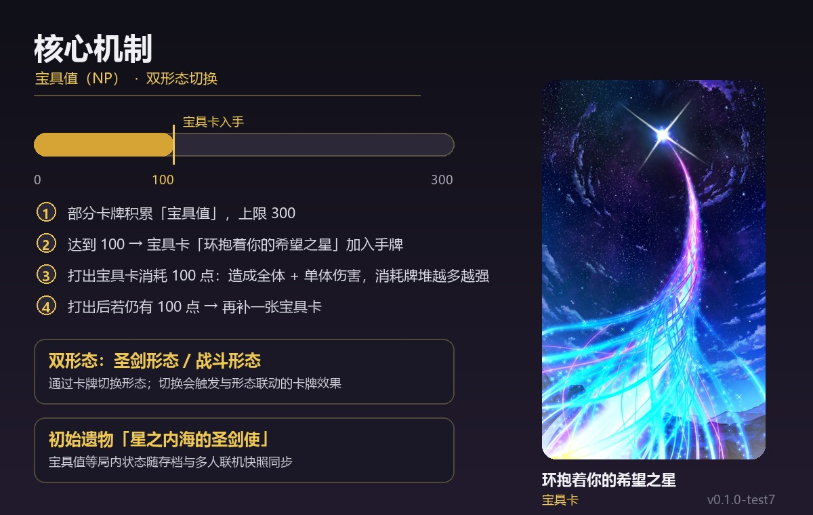

# 阿尔托莉雅·卡斯特 (Artoria Caster) —《杀戮尖塔 2》角色 Mod

> 把《Fate/Grand Order》的「阿尔托莉雅·卡斯特」作为可玩角色带进《杀戮尖塔 2》。
> A fan-made playable character mod for *Slay the Spire 2*: Artoria Caster from *Fate/Grand Order*.


## 已发布渠道

| 渠道 | 说明 |
| --- | --- |
| [Steam 创意工坊](https://steamcommunity.com/sharedfiles/filedetails/?id=3823025909) | ✅ 已公开，推荐从这里安装（Steam 自动更新） |
| GitHub（本仓库） | 源码、构建说明与版本记录 |

当前版本 **v0.1.0-test7**（测试版）｜支持游戏 **0.107.1（Steam public 分支）**｜前置依赖 **BaseLib ≥ 3.4.5**

## 角色特色

- **宝具值**：独立的 0–300 能量槽，由部分卡牌获得或消耗；达到 100 时会把宝具卡「环抱着你的希望之星」加入手牌
- **双形态**：圣剑形态 / 战斗形态，通过卡牌切换，切换会触发与形态相关的卡牌效果
- **专属初始遗物**「星之内海的圣剑使」与专属初始牌组
- **86 张卡牌**：基础 5 / 普通 17 / 罕见 34 / 稀有 25 / 先古 1 / 衍生 3 / 状态 1
- **86 张专属卡图**（其中 9 张为整图立绘风格）、角色选择立绘、两套形态各一套逐帧战斗动画、中英文卡面文案



## 安装（玩家）

### 方式 A：Steam 创意工坊（推荐）

1. 订阅前置 [BaseLib](https://steamcommunity.com/sharedfiles/filedetails/?id=3737335127)（≥ 3.4.5，必须）
2. 订阅本 Mod：[创意工坊页面](https://steamcommunity.com/sharedfiles/filedetails/?id=3823025909)
3. 启动游戏，确认「模组 / Mods」列表里 BaseLib 与本 Mod 都已启用

### 方式 B：手动安装

1. 先确保 BaseLib ≥ 3.4.5 已安装
2. 从 [Releases](https://github.com/EleinaK/MyFirstCharacter/releases) 下载最新安装包 zip，把 **`MyFirstCharacter` 整个文件夹**放进
   `<Steam>/steamapps/common/Slay the Spire 2/mods/`
3. 最终路径应为 `mods/MyFirstCharacter/MyFirstCharacter.dll`（不要再套一层同名目录）
4. 如果 `mods/` 里已有旧版手动安装，先删除或移走——游戏会优先加载本地版并屏蔽工坊版（日志里会有 WARN）

**联机**：支持多人联机。双方 Mod 版本与 BaseLib 版本必须完全一致，否则无法进入或中途断线；可搭配 AutoModSubscriber 自动补齐缺失的工坊 Mod。

## 从源码构建

环境要求：

- .NET SDK **9.0**
- Godot **4.5.1 .NET 版**（MegaDot 或官方 Godot mono；游戏不会加载用更新版本 Godot 导出的 pck）
- Steam 版《杀戮尖塔 2》**0.107.1**
- 首次构建需要联网恢复 NuGet 包（BaseLib 3.4.5 等）

```powershell
# 1) 配置 Godot 路径（把示例文件复制改名后按需修改）
Copy-Item Directory.Build.example.props Directory.Build.props

# 2) 编译 C# 并生成 dll（会自动复制到 <游戏>/mods/MyFirstCharacter/）
dotnet build

# 3) 完整发布：编译 + Godot 无头导出 pck
dotnet publish
```

说明：

- 游戏安装路径由 `Sts2PathDiscovery.props` 自动发现（Steam 注册表 / 常见安装路径）；发现失败时在 `Directory.Build.props` 里设置 `<Sts2Path>`。
- 只改 C# 代码时 `dotnet build` 即可；改了图片 / 场景 / 动画等 Godot 资源后需要 `dotnet publish`（或手动用 Godot 导出 pck）。
- 编辑 `.tscn` 与资源建议直接用 Godot 4.5.1 .NET 版打开 `project.godot`。

### 目录结构

```text
MyFirstCharacterCode/     C# 源码（卡牌、能力、遗物、补丁）
MyFirstCharacter/         Godot 资源（图片、场景、动画、本地化）
MyFirstCharacter.json     Mod 清单（id / 版本 / 依赖 / 游戏版本要求）
Sts2PathDiscovery.props   跨平台游戏安装路径发现
export_presets.cfg        Godot 导出预设（BasicExport）
docs/previews/            README 宣传图
```

## 版本记录

### v0.1.0-test7
- 修复「灾厄即妖精之恶」没有执行「并添加等量『灾厄』到你的弃牌堆」的问题；格挡计数包含消耗牌堆，卡面描述同步写清

### v0.1.0-test6
- 修复「第十一天的格洛斯特」在夏日之星形态下不获得格挡、「妖精形态」不获得力量（能力触发钩子用错）

### v0.1.0-test5
- 25 张卡牌效果按新设计调整，其中 8 张为新机制；战斗模型缩放 1.4×；夏日之星形态待机动画循环接缝修复

### v0.1.0-test4
- 首个联机测试包

## 反馈

- Steam 创意工坊页面留言（最快）
- 或提交 GitHub Issue：请附 **Mod 版本号 + 复现步骤 + 日志**（`%APPDATA%/SlayTheSpire2/logs/godot.log` 里的 `ERROR` 与 `[NP]` 行）

## English

Fan-made playable character **Artoria Caster** (Fate/Grand Order) for *Slay the Spire 2*.

- Requires **BaseLib ≥ 3.4.5** (Steam Workshop) and **game version 0.107.1 (public branch)**
- Recommended install: [Steam Workshop](https://steamcommunity.com/sharedfiles/filedetails/?id=3823025909)
- 86 cards, an NP gauge (0–300) that adds the Noble Phantasm card at 100, and a two-form switch mechanic
- Multiplayer supported; both players must use the exact same mod and BaseLib versions
- Build from source: .NET SDK 9.0 + Godot 4.5.1 (.NET), then `dotnet publish` (details above)

## 免责声明

非官方粉丝作品，与 Mega Crit、TYPE-MOON 无关。《Fate/Grand Order》角色及相关素材版权归原权利方所有，禁止商业用途。
本仓库中的代码可自由参考学习；角色立绘、卡图等美术素材请勿二次商用或未授权分发。

## 致谢

- [BaseLib](https://steamcommunity.com/sharedfiles/filedetails/?id=3737335127) — StS2 Mod 基础库
- 基于 StS2 ModTemplate 起步，卡牌美术使用 AI 绘图工具生成并整理
